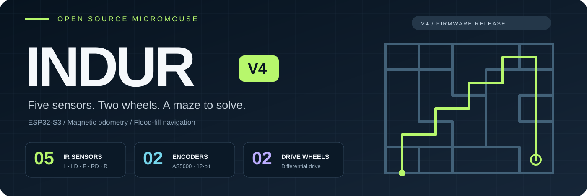
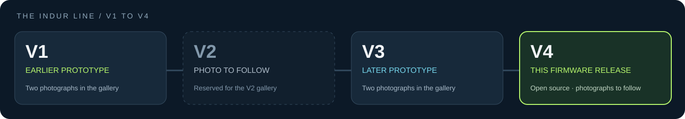
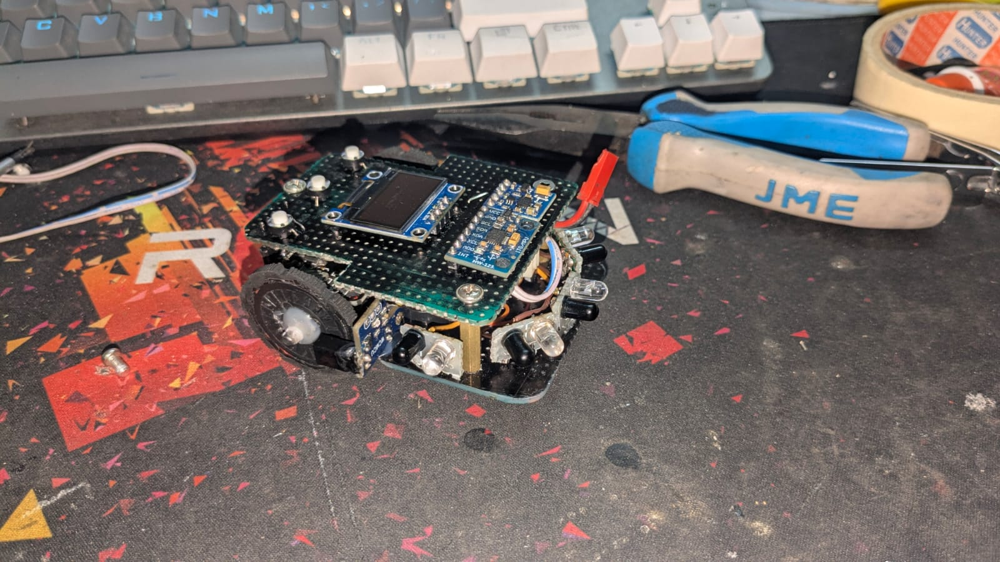
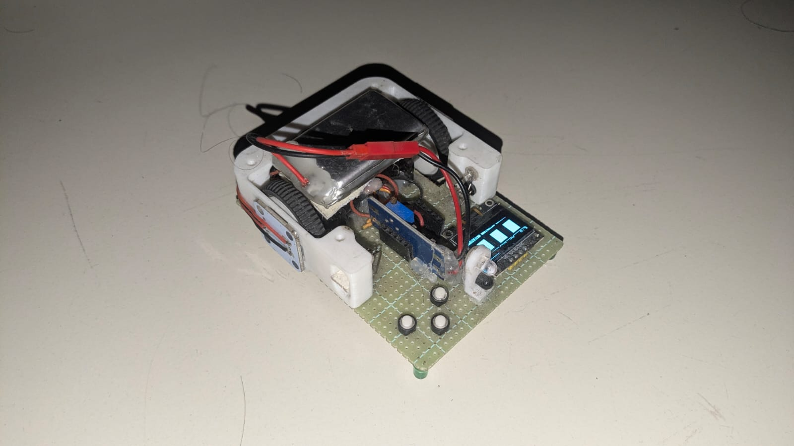
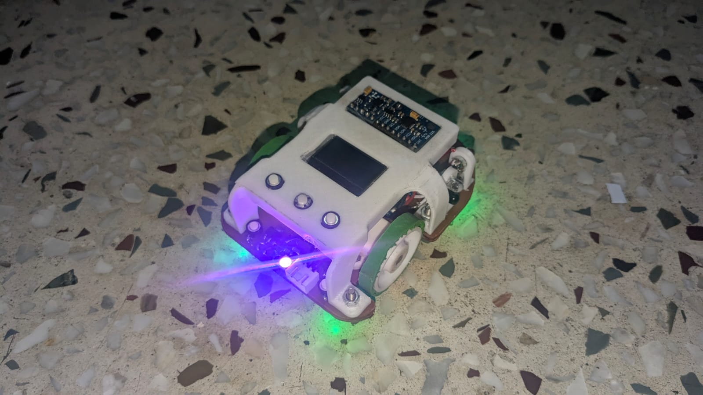
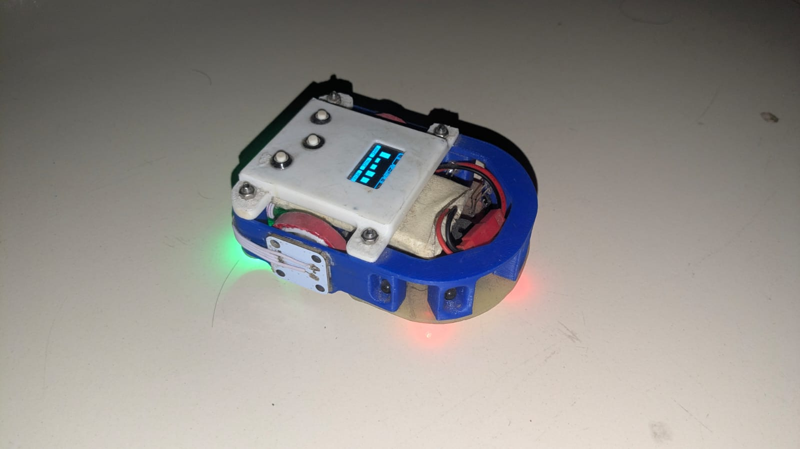
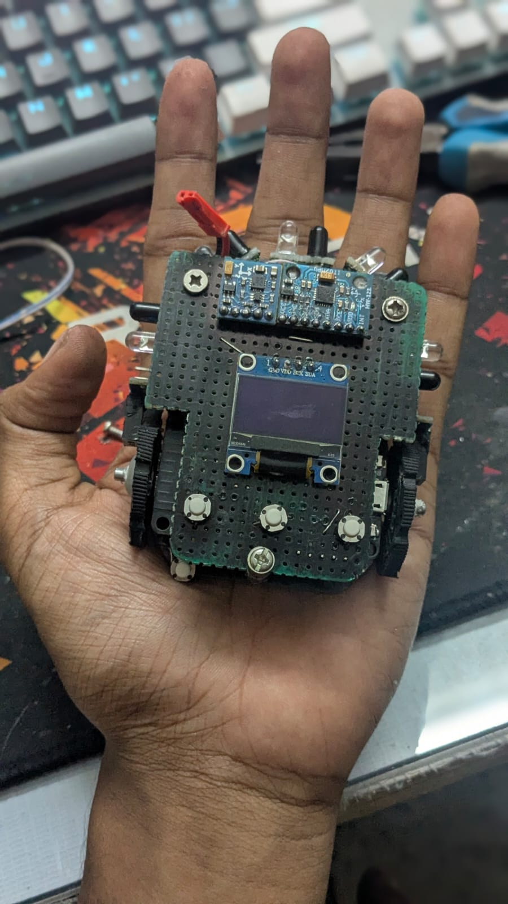
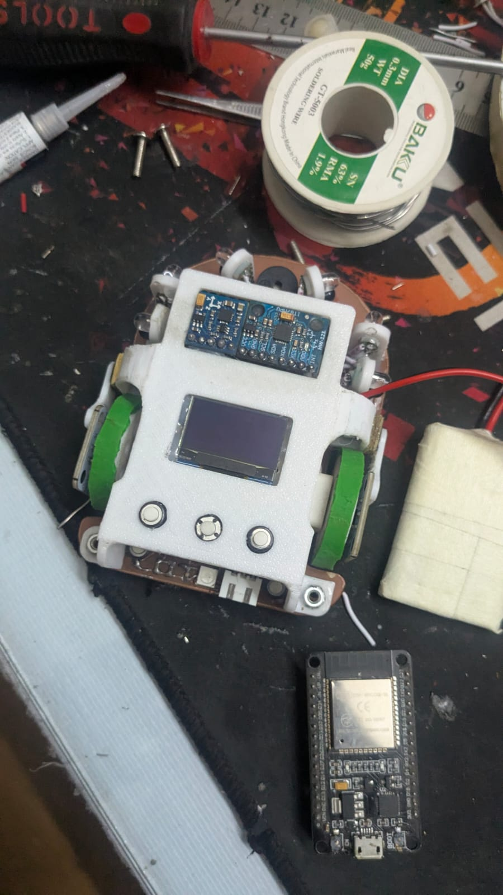
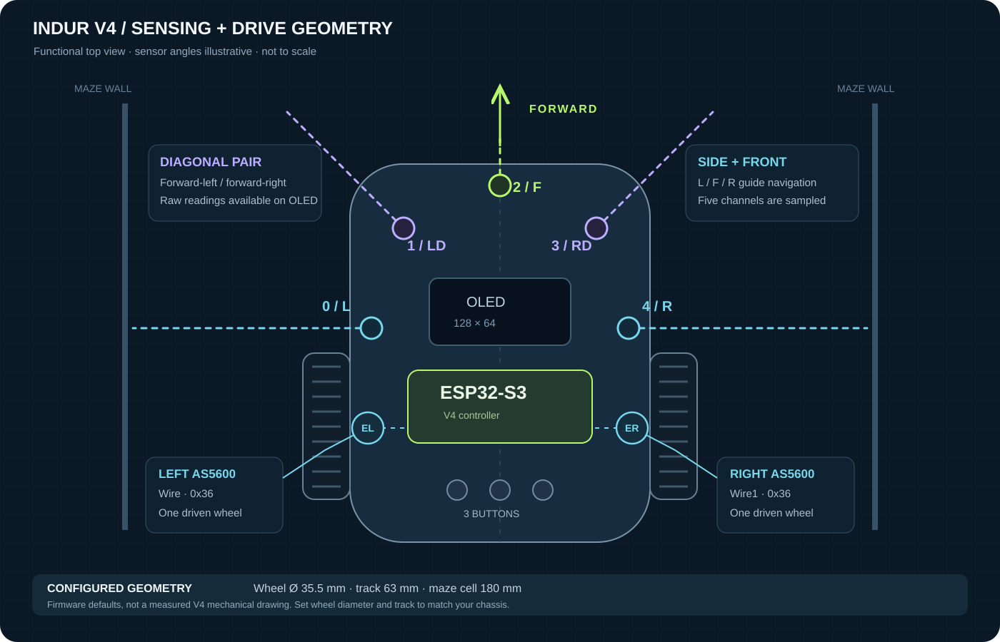
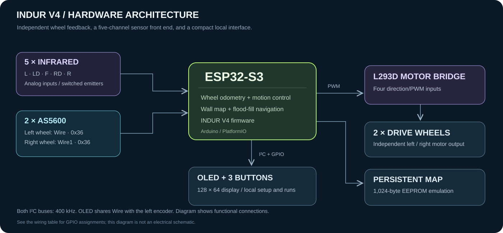

<p align="center">
  
</p>

<h1 align="center">Indur V4</h1>
<p align="center"><strong>A small robot. A complete sensing and motion system.</strong></p>

<p align="center">
  <a href="https://github.com/RakibulIslam1/indur/actions/workflows/build.yml"></a>
  
  
  
  <a href="LICENSE"></a>
</p>

**Indur is a micromouse project built around infrared wall sensing, magnetic wheel feedback, and differential drive. This repository releases the firmware for Indur V4.** An ESP32-S3 brings the sensor front end, wheel odometry, maze navigation, OLED interface, and persistent storage together in a compact autonomous robot.

The gallery below documents all four versions of Indur, from V1 to the current V4 robot. The V4 diagrams describe the released firmware's hardware arrangement; they are functional illustrations rather than dimensional CAD drawings.

<p align="center">
  <a href="#the-indur-line">Versions &amp; gallery</a> ·
  <a href="#inside-indur-v4">V4 engineering</a> ·
  <a href="#wiring-reference">Wiring</a> ·
  <a href="#build-and-flash">Build &amp; flash</a> ·
  <a href="#running-the-robot">Operation</a>
</p>

## The Indur line



<table>
  <tr>
    <td width="50%" align="center">
      <h3>Indur V1</h3>
      
      <p>Earlier prototype · workbench view</p>
    </td>
    <td width="50%" align="center">
      <h3>Indur V2</h3>
      
      <p>Second version · assembled prototype</p>
    </td>
  </tr>
  <tr>
    <td width="50%" align="center">
      <h3>Indur V3</h3>
      
      <p>Later prototype · assembled robot</p>
    </td>
    <td width="50%" align="center">
      <h3>Indur V4</h3>
      
      <p><strong>Current version · this open source firmware</strong></p>
    </td>
  </tr>
</table>

<details>
<summary><strong>More V1 and V3 photographs</strong></summary>

<table>
  <tr>
    <td width="50%" align="center">
      <h3>V1 · top view</h3>
      
    </td>
    <td width="50%" align="center">
      <h3>V3 · workbench view</h3>
      
    </td>
  </tr>
</table>

</details>

| Version | Gallery | Firmware in this repository |
| --- | --- | --- |
| **V1** | Two photographs available | Historical reference |
| **V2** | One photograph available | Historical reference |
| **V3** | Two photographs available | Historical reference |
| **V4** | One photograph and engineering diagrams available | **Current open source release** |

## Inside Indur V4



### Five sensors across the front and sides

The sensing arrangement spans the left wall, both forward corners, the space directly ahead, and the right wall. Side-facing channels support corridor observations; the forward channel detects a wall in the robot's travel direction. The diagonal pair faces forward-left and forward-right, giving additional raw observations around the front corners.

| Channel | Position / direction | Receiver GPIO | Emitter GPIO | Role in the released firmware |
| --- | --- | --- | --- | --- |
| **0 · L** | Left side, facing left | 6 | 7 | Left wall observation and wall tracking |
| **1 · LD** | Front-left, facing diagonally forward | 5 | 8 | Sampled and available on the sensor display |
| **2 · F** | Front-center, facing forward | 4 | 8 | Wall detection ahead of the robot |
| **3 · RD** | Front-right, facing diagonally forward | 11 | 7 | Sampled and available on the sensor display |
| **4 · R** | Right side, facing right | 10 | 1 | Right wall observation and wall tracking |

All five channels are sampled, while the navigation decisions use L, F, and R. Receivers feed 12-bit ADC readings, and emitters are switched during acquisition. GPIOs 7 and 8 are shared by sensor pairs in this wiring profile; that sharing is part of the physical design and must be retained when reproducing it. Sensor angles in the illustration are representative, not measured mounting angles.

Mount the optical pairs rigidly and keep their sight lines clear of wheels, wiring, and the enclosure. Thresholds should be measured against the actual maze walls because surface reflectivity, ambient light, and sensor orientation affect raw readings.

### Two driven wheels, independent magnetic feedback

Indur V4 uses a left and right drive wheel with independently controlled DC motors. Matching their motion drives the robot forward; changing the balance steers it, and opposing wheel motion rotates it. The L293D bridge supplies the two motor channels, with four direction/PWM inputs controlled by the ESP32-S3.

Each wheel has an AS5600 magnetic encoder. The sensor measures the angle of a centered, diametrically magnetized rotating magnet without mechanical contact. Correct magnet positioning is therefore part of the mechanical assembly. See the manufacturer's [AS5600 datasheet](https://look.ams-osram.com/m/7059eac7531a86fd/original/AS5600-DS000365.pdf) for the sensing and magnetic requirements.

| Configured quantity | V4 firmware default | Engineering meaning |
| --- | --- | --- |
| Wheel diameter | **35.5 mm** | Converts wheel rotation into linear travel |
| Track width | **63 mm** | Distance between the wheel centerlines used by odometry |
| Encoder scale | **4,096 counts / revolution** | 12-bit wheel-angle readings |
| Nominal travel scale | **About 0.027 mm / count** | Calculated from the default diameter and encoder scale |
| Maze cell pitch | **180 mm** | Forward distance associated with one cell |

The travel scale is an ideal conversion, not a claim of positioning accuracy. Wheel slip, tire compression, magnet alignment, and dimensional tolerances affect actual motion. Set the wheel diameter and track width to the assembled chassis. The right encoder is mounted with the opposite orientation, and its count direction is compensated in the firmware.

### Two I²C buses solve the address conflict

Both AS5600 devices use address `0x36`. The left encoder uses `Wire`, alongside the OLED at `0x3C`; the right encoder uses `Wire1`. This places one encoder on each bus so both can be addressed independently. Both buses run at 400 kHz.

The OLED and three buttons form the local operating interface. Sensor readings, drive settings, search, and route runs are available on the robot. Maze data and route information persist in a 1,024-byte EEPROM emulation region.



## Wiring reference

| Connection | ESP32-S3 GPIO / interface |
| --- | --- |
| Left motor forward / reverse | **16 / 35** |
| Right motor forward / reverse | **15 / 38** |
| IR receivers L / LD / F / RD / R | **6 / 5 / 4 / 11 / 10** |
| IR emitter controls L / LD / F / RD / R | **7 / 8 / 8 / 7 / 1** |
| OLED + left encoder SDA / SCL | **3 / 2**, `Wire` |
| Right encoder SDA / SCL | **13 / 12**, `Wire1` |
| Left / right / center button | **33 / 37 / 18** |
| Buzzer | **9** |

The bridge enable inputs are tied high; PWM is applied to its direction inputs. Buttons connect their GPIO to ground when pressed and use internal pull-ups. Power the motors through their driver, share ground with the controller, and keep signals reaching the ESP32 within its GPIO voltage limits.

The supplied board profile is `esp32-s3-devkitc-1`, with flash constrained to 4 MB and native USB enabled. A different physical board must expose the GPIOs in this table. The graphics are functional wiring aids; this release provides firmware, photographs, and documentation rather than fabrication-ready PCB or chassis files.

## Firmware profile

| Item | Indur V4 public firmware |
| --- | --- |
| Processor / framework | ESP32-S3 / Arduino |
| Maze | Fixed **13 × 13** cells |
| Starting position | Bottom-left cell, facing north into the maze |
| Default goal | Center cell **(6, 6)** |
| Optional goal | Single cell or a 2 × 2 region, selected from Settings |
| Navigation | Wall observations, flood-fill search, and stored routes |
| Motion | Encoder feedback, wall tracking, relative turns |
| Run modes | Cell runs, grouped straight segments, and fast arc mode |
| Interface | 128 × 64 SSD1306 OLED, three buttons, USB serial |
| License | MIT |

Search builds a wall map, reaches the configured goal, returns, checks the candidate route, and saves the result. It stops after saving; a route run is selected separately. Straight motion retains wall tracking and departure-heading feedback, while turns use relative encoder feedback. Starting alignment and encoder magnet setup are manual assembly and placement tasks in this public release.

The source keeps standard C++ formatting and numeric filenames: `1.cpp` through `14.cpp`, plus `15.h` and `16.h`.

## Build and flash

Install PlatformIO Core or the PlatformIO extension for VS Code. The project pins Espressif32 `6.13.0`, Adafruit SSD1306 `2.5.17`, and Adafruit GFX `1.12.6`.

```bash
git clone https://github.com/RakibulIslam1/indur.git
cd indur
python -m pip install platformio==6.2.0
python -m platformio run -e indur
python -m platformio run -e indur -t upload
python -m platformio device monitor -b 115200
```

Use `--upload-port` for a specific upload device and `--port` for a specific monitor device when more than one board is attached. The build writes its image to `.pio/build/indur/firmware.bin`. Native USB and upload/monitor speeds are configured in `platformio.ini`.

## Running the robot

Start with the wheels lifted and confirm motor direction and encoder response. Then measure the IR thresholds against the intended walls, set the wheel geometry, and verify short moves and turns at a moderate speed before using a stored route.

| Home control | Short press | Hold longer than 300 ms |
| --- | --- | --- |
| **Left** | Left-hand wall rule | Right-hand wall rule |
| **Center** | Stored route at moderate speed | Flood-fill search |
| **Right** | Main menu | Stored-route speed selection |

Short left/right presses browse the main menu. Hold right to select and hold left to return. The menu provides Settings, Analog Read, Dist. Read, Motor Check, Wall Follow, Debug Toggle, Flood Fill, Run Path, Clear Maze, and Fast Run.

For search or a hand-rule run, place the robot in the bottom-left start cell facing north and allow for the initial **50 mm entry movement**. Stored-route runs start at the cell center with the same orientation. Press either side button to stop during motion. Clear the saved maze when the track changes.

Fast Run performs a segmented outward run, returns, and then uses the higher-speed arc mode. Stored-route modes require confirmed open edges along their route; begin with normal Run Path while tuning the chassis.

<details>
<summary><strong>Settings and practical calibration</strong></summary>

The eighteen settings cover drive speed, motor balance, turn speed, movement and turn braking, wall Kp/Kd, wheelbase, wall setpoint, straight Kp, turn deceleration, wheel diameter, three wall thresholds, and the goal mode and coordinates.

In the settings list, short presses browse and holding right opens an item. In the editor, short left increases and short right decreases the value; hold right to save and hold left to discard. Saved settings are applied immediately and restored after reboot.

| Default when stored data is invalid | Value |
| --- | --- |
| Drive / turn PWM | 150 / 100 |
| Movement / turn brake | 50 / 40 ms |
| Wall Kp / Kd | 20 / 50 |
| Straight Kp | 30 |
| Turn deceleration zone | 30 degrees |
| Side / front wall thresholds | 1000 / 220 ADC units |
| Wall tracking setpoint | 205 ADC units |

Analog Read shows all five raw sensor channels. In this receiver circuit, wall detection occurs when the reading falls below its threshold. Dist. Read uses inherited conversion coefficients and remains an estimate until calibrated against the installed sensors; navigation uses raw wall readings.

Motor Check starts at zero PWM. Short presses change the target, holding right applies it, and holding left stops and returns. Keep the wheels lifted during this check.

</details>

<details>
<summary><strong>USB diagnostics</strong></summary>

The idle-screen console supports `?` for help, `p` for status, `z` to reset distance counters, and `!` to stop motors. These commands are serviced on the home screen; use the side buttons during a run. Debug Toggle enables additional serial output.

</details>

## Validation and contributions

The firmware is built for the ESP32-S3 target before publication. Native checks cover relative turn selection, flood-fill distances against independent breadth-first searches, route verification, EEPROM round trips and corrupted records, and failed-movement position handling. GitHub Actions builds pushes and pull requests.

Physical turn accuracy, sensor calibration, battery behavior, and maze times require testing on the assembled robot. The diagrams and configured dimensions do not substitute for those measurements, and no competition ranking or timing result is claimed.

For an issue or pull request, include the board, motor driver, wheel dimensions, settings, observed behavior, and build output. Keep changes compatible with the published hardware profile.

## License

The project source is released under the [MIT license](LICENSE). Third-party libraries are downloaded separately by PlatformIO and retain their own licenses.
